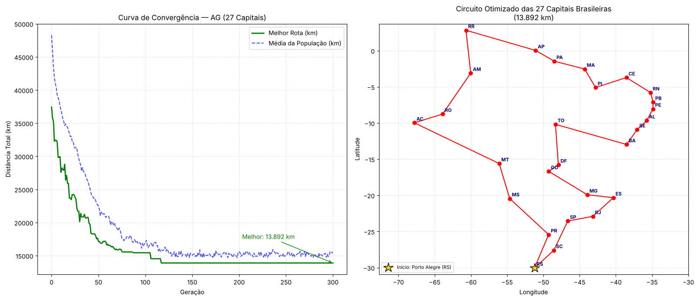

# Marco 1 — Algoritmo Genético para o TSP das 27 Capitais Brasileiras

**Tópicos Avançados em Computação I** — IFPA Campus Ananindeua — Prof. Fabio Ferreira

**Equipe:** Ederson Costa Moreira Filho · Ilard Moisés da Silva Lamarão · João Vitor de Almeida Miranda

## Sobre

Este projeto resolve o Problema do Caixeiro Viajante (TSP) para as 26 capitais estaduais + Brasília (27 cidades, cerca de 2,01 × 10²⁶ rotas possíveis). Ele usa um Algoritmo Genético implementado com a biblioteca [DEAP](https://github.com/DEAP/deap).

| Componente | Configuração |
|---|---|
| Distâncias | Haversine (km), matriz 27 × 27 |
| Fitness | Comprimento do circuito fechado (minimização) |
| Representação | Permutação dos índices 0–26 |
| Crossover | `cxOrdered` (OX), p = 0,85 |
| Mutação | `mutShuffleIndexes` (indpb = 0,05), p = 0,20 |
| Seleção | Torneio (k = 3) |
| População / Gerações | 200 / 300 (`eaSimple`, semente 42) |

## Resultado

- **Melhor rota:** 13.892 km (0,76% acima da referência 2-opt de 13.787 km)
- **Tempo de execução:** cerca de 2 s

## Arquivos

- `Marco1_TSP_27Capitais_AG_Equipe.ipynb`: notebook executado, com análise e conclusões
- `tsp_27capitais_ag_equipe.py`: script equivalente (`python tsp_27capitais_ag_equipe.py`)
- `resultado_ag_tsp.png`: curva de convergência e mapa da rota

## Como executar

Abra o notebook no Google Colab e use *Ambiente de execução → Executar tudo*. O DEAP é instalado automaticamente, se necessário.
